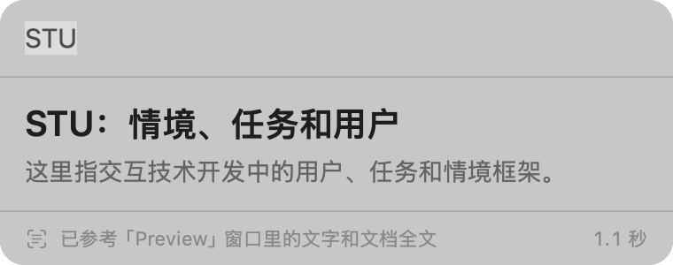

# Lite Translation

macOS 菜单栏上的上下文翻译工具。选中一个词按 ⌥D，它会先看你屏幕上正在读的内容和所开 PDF 的全文，再给出贴合语境的翻译。全程在本机运行，不联网。

*Context-aware translation for macOS. Select text, press ⌥D, and get a translation that fits what is on your screen and in the PDF you are reading. Fully on-device. Requires macOS 27 or later on a Mac that supports Apple Intelligence.*

> **使用前提**：只能在支持 Siri AI（Apple 智能）的 Mac 上使用，系统需要 macOS 27 或更高版本。详见[系统要求](#系统要求)。



## 它解决什么问题

普通翻译工具只看你选中的那个词，所以给的是字典里的第一个意思。Lite Translation 会带上这个词周围的内容：

- **屏幕上下文**：`viscosity` 单独翻译是“黏度，指液体流动时的阻力”。在一篇讨论界面工具包的论文里选中它，得到的是“开发阻力”。
- **文档全文**：论文第 6 页用到的缩写 `STU`，定义在前面第 4 页。只看当前这一屏会译错；读过全文后给出的是“STU：情境、任务和用户”。

翻译由一个小型本机模型完成，同一个词的结果会随上下文变化，偶尔也会出错。

## 功能

- **选中翻译（⌥D）**：翻译当前应用里选中的文字，结果显示在鼠标旁的悬浮窗里。
- **输入翻译（⌥A）**：唤出输入框，输入词或句子后回车。
- **屏幕上下文**：截取当前窗口并在本机识别文字，取出目标词所在段落及其前后文。双栏排版按正确的阅读顺序处理。
- **文档全文**：当前窗口是带文字层的 PDF 时，额外参考文档的标题、摘要，以及这个词在文档里最早出现的句子。
- **词和句子分别处理**：词或短语给出译法和一句话解释；整句或段落只给译文。
- **中英互译**：中文译成英文，其他语言译成简体中文。
- **登录时自动启动**：首次运行时开启，可在菜单里关闭。

按 Esc 或点击别处关闭悬浮窗。

## 系统要求

- **支持 Siri AI（Apple 智能）的机型**：必须是搭载 Apple 芯片的 Mac，并且已在“系统设置 › Apple 智能与 Siri”里开启。翻译完全依赖这个系统自带的本机模型，在不支持或没有开启的 Mac 上无法使用。
- **macOS 27 或更高版本**

## 安装

1. 从 [Releases](https://github.com/QianMo0729/Lite-translation/releases/latest) 下载 `LiteTranslation-<版本>.zip`，解压后把 `Lite Translation.app` 拖进“应用程序”文件夹并打开。应用已用 Developer ID 签名并经过 Apple 公证。
2. 首次启动时按提示在“系统设置 › 隐私与安全性”里授予两项权限：

   | 权限 | 用途 |
   |---|---|
   | 辅助功能 | 读取选中的文字，以及当前窗口所打开文档的路径 |
   | 屏幕录制 | 截取当前窗口，用来识别屏幕上的文字 |

3. 授予屏幕录制后，从菜单栏图标退出应用再重新打开一次。

没有屏幕录制权限时翻译仍然可用，只是不带屏幕上下文。菜单栏图标的菜单里可以看到两项权限和本机模型的状态。

## 工作原理

```
按下快捷键
 ├─ 读取选中的文字（辅助功能接口；读不到时模拟一次 ⌘C，随后恢复剪贴板）
 ├─ 截取当前窗口 → 本机识别文字 → 选出目标词所在段落和前后文
 └─ 找到窗口对应的 PDF → 读取全文 → 取出文档开头和这个词最早出现的句子
        ↓
   macOS 自带的本机语言模型 → 悬浮窗里逐字显示译文
```

三路读取同时进行。读屏幕和读文档最多等 1.5 秒，等不到就先不带上下文翻译。悬浮窗底部会注明这次参考了什么，以及总耗时；把鼠标停在耗时上可以看到每一步的毫秒数。

在 M5 Pro 上实测的各步耗时：

| 步骤 | 耗时 |
|---|---|
| 截取窗口 | 约 0.1 秒 |
| 识别文字 | 约 0.4 秒 |
| 读取 PDF 全文（8 页，之后有缓存） | 约 0.1 秒 |
| 模型输出完整译文 | 约 0.8 秒 |

## 隐私

- 截图、识别出的文字、PDF 内容和翻译请求都只在本机处理，应用不发起任何网络请求。
- 截图只存在于内存中，识别完即丢弃，不写入磁盘。
- 翻译使用 macOS 自带的语言模型，不需要账号或 API key。

## 已知限制

- 本机模型较小，生僻术语和长难句的质量不如云端大模型。
- 扫描版 PDF 没有文字层，只能使用屏幕上下文。
- 每次 macOS 更新后，系统需要重新编译文字识别模型，其间约一分钟内的翻译不带屏幕上下文，悬浮窗底部会有提示。
- 快捷键固定为 ⌥D 和 ⌥A，界面只有简体中文。

## 从源码构建

需要 Xcode 27（macOS 27 SDK）。

```sh
./build.sh
open "build/Lite Translation.app"
```

`build.sh` 会用钥匙串里的第一张 Developer ID Application 证书签名，没有证书时退回临时签名；也可以用 `SIGN_IDENTITY` 指定。macOS 把辅助功能和屏幕录制的授权绑定在签名上，临时签名每次构建都会变，授权需要重新给。

发布经过公证的版本：

```sh
NOTARY_PROFILE=<notarytool 钥匙串配置名> ./release.sh
```

产物在 `build/dist/LiteTranslation-<版本>.zip`，版本号取自 `Support/Info.plist`。

### 项目结构

```
Sources/
  LiteTranslationCore/   屏幕文字识别、上下文选取、PDF 全文、提示词、本机模型（不含界面）
  LiteTranslation/       菜单栏应用：快捷键、读取选区、截取窗口、悬浮窗
  PipelineProbe/         命令行工具：对一张图片跑“识别 → 上下文 → 翻译”并打印每步结果
Support/Info.plist       应用包信息
build.sh, release.sh     打包签名、公证发布
```

翻译后端通过 `Translator` 协议接入，替换成其他模型不需要改动应用的其余部分。

### 调试

不经过界面检查识别和翻译：

```sh
swift run -c release PipelineProbe <图片> <要翻译的词> [--pdf <文档>]
```

让应用自己跑一次输入翻译并打印结果后退出。这种运行不注册快捷键，也不显示菜单栏图标，不会影响正在使用的那一份：

```sh
LT_DEBUG_QUERY=<词> "build/Lite Translation.app/Contents/MacOS/LiteTranslation"
```

可选的环境变量：`LT_DEBUG_SCREENSHOT`（用图片代替窗口截图）、`LT_DEBUG_DOCUMENT`（用指定 PDF 代替窗口里的文档）、`LT_DEBUG_SNAPSHOT`（把悬浮窗画面存成 PNG）。
